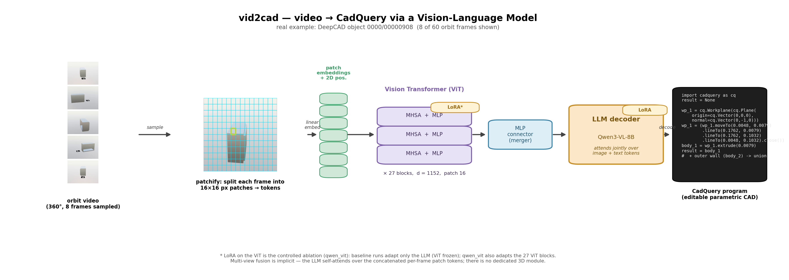
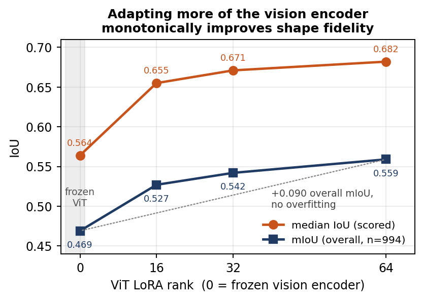
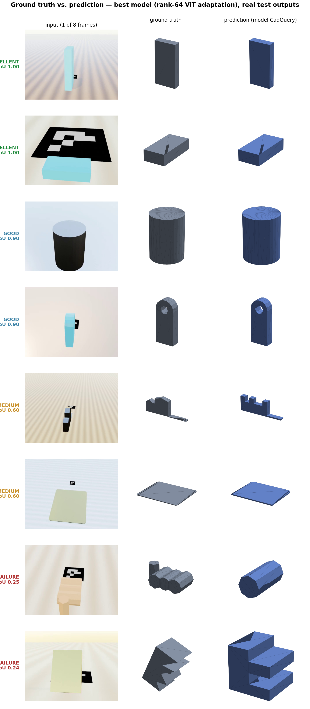
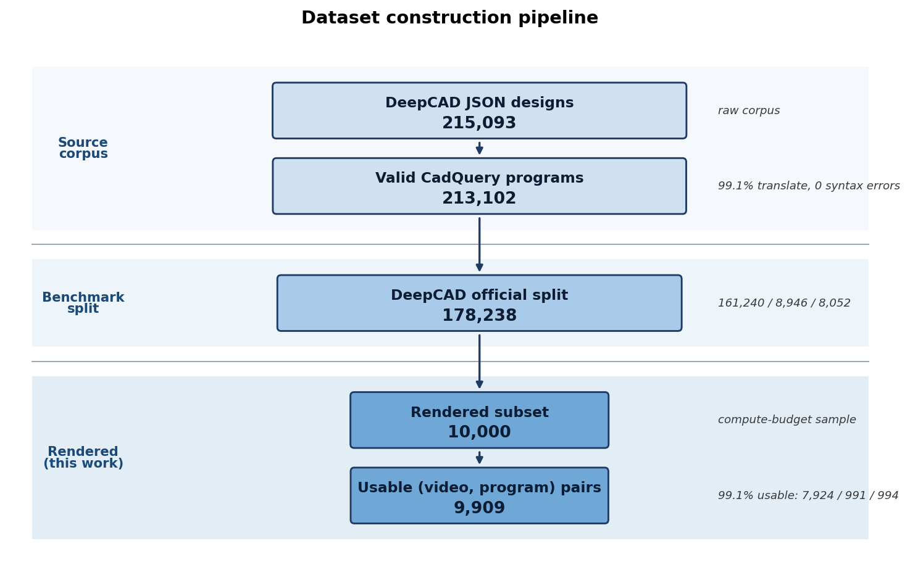

# vid2cad

Reconstruct a parametric CAD model from a short orbit **video** of a part.

Given an orbit video of a single mechanical part, vid2cad generates an executable
[CadQuery](https://github.com/CadQuery/cadquery) Python script whose execution rebuilds
the solid: an editable, ~30-line program that keeps the sketch-and-extrude history a
scanned mesh throws away. The pipeline turns the [DeepCAD](#data-sources) corpus into
rendered orbit videos, then LoRA-fine-tunes vision-language models (VLMs) to translate
those videos back into CadQuery. Reconstructions are scored geometrically (volumetric IoU
and Chamfer distance) against the ground-truth solid.

Written up as a CS 231N (Stanford) final project report:
*Vid2CAD: An End to End Method of Generating Parametric Objects from Video Clips*.



**Main finding: the vision encoder is the bottleneck.** Applying LoRA to the vision
transformer as well as the LLM is the single most effective lever for shape fidelity. It
improves per-part geometry, while self-training and explicit depth input mostly improve
code validity.

## Final results

All numbers use greedy decoding on the frozen **994-object held-out test split**
(`stage2b/test.jsonl`, inherited from DeepCAD's official split). Predicted and
ground-truth solids are unit-normalized before scoring.

- **mIoU (overall)** is the *primary metric*: mean volumetric IoU over all 994 objects,
  with programs that fail to execute scored 0.
- **Exec %** is the share of generated programs that run and produce a valid solid.
- **median** is the median IoU over programs that executed.
- **≥0.7** is the number of objects (out of 994) reconstructed with IoU ≥ 0.7.
- **Chamfer** is the median Chamfer distance on unit-normalized surfaces (lower is better).

### Best model

| Model | Exec % | **mIoU (overall)** | median IoU | IoU ≥ 0.7 | Chamfer ↓ |
|---|---|---|---|---|---|
| Qwen3-VL-8B, frozen ViT (baseline) | 88.9 | 0.469 | 0.564 | 326 | 0.059 |
| Qwen3-VL-8B, ViT LoRA rank 64 (**best in paper**) | 93.8 | **0.559** | 0.682 | 449 | 0.043 |
| Qwen3-VL-8B, ViT LoRA rank 64 + difficulty-balanced data (**best overall**, post-paper) | **95.7** | **0.577** | **0.692** | **468** | **0.041** |

The `qwen_vit_r64_bal` row was run after the report was submitted. It duplicates
non-orthogonal (angled/curved) training parts from 30.9% to 47.5% of samples. The gain
comes from rescuing previously failing hard parts (curved mIoU 0.284 → 0.326) with no
regression on box-like parts. See Table G in
[`stage3/results_table.md`](stage3/results_table.md).

### Four VLMs under an identical LoRA recipe

LoRA r=16/α=32, 3 epochs, effective batch 8, lr 1e-4 cosine, bf16, 8 frames.

| Model | Vision encoder | Exec % | **mIoU** | median | Chamfer ↓ |
|---|---|---|---|---|---|
| **Qwen3-VL-8B** | native-res ViT | 88.9 | **0.469** | **0.564** | **0.059** |
| InternVL3-8B | InternViT (tiled) | 95.5 | 0.447 | 0.483 | 0.075 |
| GLM-4.1V-9B | EVA/AIMv2-lineage ViT | 90.0 | 0.410 | 0.450 | 0.083 |
| Kimi-VL-A3B† | MoonViT | 92.7 | 0.220 | 0.173 | 0.231 |

†4 frames and 4-bit QLoRA because of memory limits.

A higher execution rate does not mean better shape fidelity. InternVL writes the most
runnable code but builds the wrong solid more often than Qwen.

### Interventions on Qwen3-VL-8B

| Intervention | Exec % | **mIoU** | scored mIoU | median | IoU ≥ 0.7 | Chamfer ↓ |
|---|---|---|---|---|---|---|
| Baseline (frozen ViT) | 88.9 | 0.469 | 0.533 | 0.564 | 326 | 0.059 |
| + RFT / STaR self-training | 95.7 | 0.500 | 0.526 | 0.553 | 353 | 0.058 |
| + depth frames | 92.9 | 0.485 | – | 0.561 | 345 | 0.055 |
| + ViT adaptation (r16) | 91.4 | 0.527 | 0.584 | 0.655 | 416 | 0.044 |
| + RFT **and** ViT adaptation | 94.2 | 0.519 | 0.557 | 0.595 | 385 | 0.050 |
| ViT adaptation (r64) | 93.8 | 0.559 | 0.605 | 0.682 | 449 | 0.043 |

- **ViT adaptation** is the only intervention that raises *scored* mIoU (+0.050), which
  means a real per-part fidelity gain rather than only more parts executing.
- **RFT/STaR** buys code validity (+6.8 pts execution) but not per-part fidelity.
- **Depth input** helps far less (+0.016) than adapting the RGB encoder (+0.058).
- RFT and ViT adaptation are **substitutive, not additive**. Self-distilled targets are
  geometrically looser than the exact ground truth.

### Scaling ViT adaptation



Raising the ViT LoRA rank (0 → 16 → 32 → 64) improves mIoU monotonically
(0.469 → 0.527 → 0.542 → 0.559) with no overfitting. Validation loss kept falling, and
the curve has not saturated. Frame count is *not* a lever: 8 → 10 frames changes mIoU by
less than 0.005 at both rank 32 and rank 64.

### Decoding

On the baseline, 110/994 outputs fail to execute, and about 93% of those are surface-level
Python errors (81 `SyntaxError`, 21 `NameError`). The cause is greedy repetition
collapse, not truncation. Best-of-N sampling recovered all failures on a 100-object slice
(93% → 100% execution) without retraining. Repetition penalties made things worse.

### Qualitative results (best model)



Example orbit videos for these test parts are in
[`paper/figures/videos/`](paper/figures/videos/), named `<bucket>_<id>_iou<score>.mp4`.
For example, [a perfect reconstruction (IoU 1.00)](paper/figures/videos/0002_00027709_iou1.00.mp4)
and [a failure case (IoU 0.24)](paper/figures/videos/0050_00507636_iou0.24.mp4).

Full per-table analysis is in [`stage3/results_table.md`](stage3/results_table.md).

### Limitations and open work

- All evaluation is **synthetic** and at normalized scale. The sim2real gap on real phone
  captures (Table F) has not been measured yet.
- Models are trained on a 10k-object subset of DeepCAD.
- The best-of-N decoding result was validated on 100 objects, not the full test set.
- A scale-up run (+20k stratified renders at 960×720, ViT LoRA rank 128; Table H) was
  built but has no results yet.

## Data sources

vid2cad trains only on data derived from **DeepCAD**. No datasets, rendered videos or
checkpoints are redistributed in this repo; they are listed in `.gitignore`.

| Source | How it is used | Link |
|---|---|---|
| **DeepCAD** (Wu, Xiao & Zheng, ICCV 2021) | **Training/eval data.** 215,093 JSON sketch-and-extrude designs and the official train/val/test split. Translated to 213,102 CadQuery programs (Stage 0). A 10k-object subset of the official split is rendered, giving 9,909 usable pairs (7,924 train / 991 val / 994 test). | [paper](https://arxiv.org/abs/2105.09492) · [code & data](https://github.com/ChrisWu1997/DeepCAD) |
| **ABC dataset** (Koch et al., CVPR 2019) | Upstream source of the Onshape models DeepCAD is built from. Not used directly. | [paper](https://arxiv.org/abs/1812.06216) · [site](https://deep-geometry.github.io/abc-dataset/) |
| **CAD-Recode** (Rukhovich et al., ICCV 2025) | Prior work whose CadQuery target representation we adopt, and the point-cloud format Stage 2 produces. Its dataset is not used for training. | [paper](https://arxiv.org/abs/2412.14042) · [code](https://github.com/filaPro/cad-recode) |

Fusion 360 Gallery and Objectron were considered and not used. Fusion 360 Gallery is
smaller, and Objectron has no parametric-CAD ground truth.

### Pretrained models (fine-tuned with LoRA)

| Model | Hugging Face ID |
|---|---|
| Qwen3-VL-8B (main backbone) | [`Qwen/Qwen3-VL-8B-Instruct`](https://huggingface.co/Qwen/Qwen3-VL-8B-Instruct) |
| InternVL3-8B | [`OpenGVLab/InternVL3-8B-hf`](https://huggingface.co/OpenGVLab/InternVL3-8B-hf) |
| GLM-4.1V-9B | [`zai-org/GLM-4.1V-9B-Thinking`](https://huggingface.co/zai-org/GLM-4.1V-9B-Thinking) |
| Kimi-VL-A3B | [`moonshotai/Kimi-VL-A3B-Thinking-2506`](https://huggingface.co/moonshotai/Kimi-VL-A3B-Thinking-2506) |

### Tools

[CadQuery](https://github.com/CadQuery/cadquery) 2.7 executes programs to solids.
[Blender](https://www.blender.org/) EEVEE renders the orbit videos.
[OpenCV](https://opencv.org/) ArUco generates the metric-scale fiducial marker.
[Open3D](https://www.open3d.org/) does the TSDF point-cloud fusion.

## Pipeline



```
DeepCAD JSON ──▶ CadQuery .py ──▶ STL ──▶ Blender orbit render ──▶ video + depth + masks + camera poses
   (Stage 0)        (Stage 0)              (Stage 1)
                                                │
                          ┌─────────────────────┴───────────────────────┐
                          ▼                                              ▼
              TSDF point-cloud fusion                        sampled RGB / depth frames
                  (Stage 2)                                        (Stage 2b)
                          │                                              │
                          └──────────────▶ VLM fine-tune ◀──────────────┘
                                       video → CadQuery
                                          (Stage 3)
```

### Stage 0: Translation (`translator/`, `run_all.sh`)
DeepCAD's ~215k JSON CAD designs are translated into executable CadQuery `.py`
scripts (`run_translation.py`). Each script is then validated by executing it in a
subprocess and checking that it produces a valid solid (`run_validation.py`, with a
slow-retry pass for timeouts). Output: `deepcad-data/cadquery_py/<bucket>/<id>.py`.

### Stage 1: Rendering (`stage1/`)
Each CadQuery script is executed to an STL, placed on an ArUco-marked ground plane, and
rendered as a 60-frame **orbit video** (640×480, 24 fps) with Blender EEVEE. Per object
we save `video.mp4`, per-frame **depth EXRs**, **mask EXRs**, and `cameras.json`
(OpenCV-convention intrinsics and world-to-camera poses). This runs as a Slurm array job
over a 10k-object subset.
*Unit note:* all `_mm` fields are Blender scene units (1 unit = 1000 real mm).

### Stage 2: Point-cloud fusion (`stage2/`)
Depth maps, masks and camera poses are fused by TSDF integration into a metric point
cloud. It is centered and scaled to `[-0.5, 0.5]³`, then downsampled to 8192- and
256-point PLYs for CAD-Recode-style point→CAD conditioning. These point clouds are not
used by any model reported above.

### Stage 2b: Frame and manifest prep (`stage2b/`)
Samples 16 RGB frames from each orbit video into JPGs and builds the
`train/validation/test.jsonl` manifests that Stage 3 consumes. For the depth experiment,
it also produces TURBO-colormapped **depth frames** aligned to the RGB frames
(`make_depth_frames.py`).

### Stage 3: VLM fine-tuning and evaluation (`stage3/`)
LoRA-fine-tunes VLMs on `(orbit frames → CadQuery script)` pairs. `eval.py` runs the
held-out test set and executes each predicted script, and `eval_geom.py` scores
**volumetric IoU and Chamfer** against the ground-truth solid.

Experiment tracks:
- **ViT adaptation** (`qwen_vit*`): LoRA also adapts all 27 vision-transformer blocks
  (qkv, proj, fc1, fc2) as well as the LLM. Includes the rank sweep.
- **Difficulty-balanced data** (`build_balanced_manifest.py`, `train_qwen_vit_bal.sbatch`).
- **RFT** (rejection-sampling self-distillation): sample K=8 candidates per object, keep
  the best-IoU executable one (IoU ≥ 0.5), and SFT on them (`rft_sample.py` →
  `rft_select.py` → retrain).
- **Depth conditioning**: interleave depth frames with RGB (`config_depth.yaml`).

## Running it

The pipeline runs on Stanford FarmShare with Slurm-submitted array jobs.

```bash
module load python/3.13.5          # required before any python3/pip call
# Stage 0: get DeepCAD data (see github.com/ChrisWu1997/DeepCAD) into deepcad-data/, then
sbatch run_all.sbatch
# Stage 1 (render a subset)
bash stage1/submit_stage1_subset.sh --manifest stage1_output/subset_manifest.txt \
    --output_dir stage1_output --aruco_marker aruco_marker.png
# Stage 2 (point clouds)
bash stage2/submit_stage2.sh --data_dir stage1_output
# Stage 3 (train + eval), e.g. the ViT-adaptation run
sbatch stage3/train_qwen_vit.sbatch
```

The manifests in `stage2b/*.jsonl` contain absolute paths from the original cluster.
Rewrite them to point at your own render output before training.

## Citation

If you use the data pipeline, please cite DeepCAD:

```bibtex
@inproceedings{wu2021deepcad,
  title     = {DeepCAD: A Deep Generative Network for Computer-Aided Design Models},
  author    = {Wu, Rundi and Xiao, Chang and Zheng, Changxi},
  booktitle = {Proceedings of the IEEE/CVF International Conference on Computer Vision (ICCV)},
  pages     = {6772--6782},
  year      = {2021}
}
```
